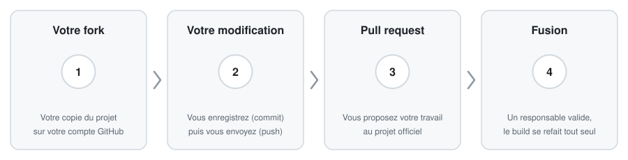

# Survisland

[![Powered by StewBeet](https://img.shields.io/badge/Powered%20by-StewBeet-5865F2?colorA=%23E00000&colorB=%2300A000&logo=data:image/png;base64,iVBORw0KGgoAAAANSUhEUgAAACAAAAAgCAYAAABzenr0AAAHDklEQVRYR8VWe1BcVxn/nbvvXR7lkYQi0NAspAKBJpqWxPQBU1p0Wk3UmoeSGuPYarSOMzp1tHY6Y5s/bDvTxk46WmvsVK2mgbYzjnlhSaahXWKkAUIMCSFpnRAeIQR22ce9e+/xd1mWLgyLrPmjF87sued85/t+3+/7vvNdgU/4ESnaN+VlimfmFU8VQAZyMKjYhdN21X5LJBLpmdL+fwNLCqC3u61WSJm1rKK6McGF1207sVGzKMBjxglkZdVhdHSM+wXwYL+IoF9GcV8qDCUH0Ok7462svmWWsl6xE8tEN1dvBYxn+TuInco6/ExZD6n3KULutnwL0PYsFERyAB1tPVDEPd4Vt/1nStldrk04El4pINollLuB6O8Ax6cAtYaJ8U9A5ALKLvsmHepfrwuAlFJcvHgyMzoeHoW0VHirVp8WQqRblmNM/zZV7wJcPwL0N2l4Df0dACylfD/AveOohIqu6wLQd7r9ppvLVn1oKjnb2WqUVn6OQZ98XnL8Eo+oEcA5BIRKABvJ1siR5SHASgYiT1p/Tm52XhcAk4HzXb5D3so1db2dvrfdudbN+fmfDVLpj9N/gGf85Zz9gWMxaY8yDMVAuIjvj2EUTyKXwyzVBZVr0hw41+UbK1lRnXmu472ukqq1KxI86rLsQIXezpVCjn56/igT8rcczWBA4OOwwY4zdtjvV1X13/OxMSeAvq627bqURXDhOaehbCxcftvLs5S8YS3GV51MvtAbjL3f0sb933C2x2LBbj0HD9p+gRztaWjuAffSIIKXk4GYE0Bvh6/HW1W9fMYhK+oRxdYyEn8WWELmK0xHYdXM9YNxWcdqUt/AXKCQjexoTaANF7kKxatphtq5AXS+v0u6xOMlJdXjMWnR+orIXLtNujjXMYQAxoWOQ1ZdPqcZ/gsw6rhx3JS03oTWaA3W2lbS+A9hoBR+3hyZ2O/cSBB7ZzORNAeGe301i7zVLTzwq2Mi+ycVMgthWOksY806Y63TNRUZXHkE43gL+hMqlGw4jYaMWmQHjgihrJGIruKBM2TjgG2VpmkfLBhAXJCU6+1KgXLBoHfMLNN8/OIXhBEmCEUEsVn40SwVnJcG7qSUCjxl+QIet3pZDkSt7rZtJSevLQiAlBB5eXAPDlqbNkDe+2vWWxiOKcOx6jJBEBMiNOXHNTwjJJ4lgKf53iOi8pgUwrZUQhuhkB/m9fXKXIk4OwTTXS3N6ZAb7qiQlw6fFH/GDdSRxvMKDRvMMiKcnIHZoGKCIXhBqAhJHWwEqGP5DCOIBylXdHupbG7vFQHNiNua0TkTAQg3kMfb5u2i7ExvbXlhVpOvG+Ma0EPjOoeFIVCo1IQQ5SzM1ZHJPFCxhSxsEU7skE4CcsNJyC0My3dsFty1shw9ff1XLgxfuUh8TEb0xdmYzcCprTVrylpOnRP9I2N49Ev34e/tHSj7cBgvIR1jBBBlJqjQcIXk6/xLJ6znubOPO8+LdNQz4Cc4f5UyPXnFqL9jNV5u3IfC7BuwrrRQ7jtx+mxE1aa77GwAR75bV3vnH9/1Bf3hYIf3xqK1NpvA4sJlKGt9Bz9FHj2W+Bu9PU4AbnsuupmX4x5efHayY3XDlZaNwvyb4XAY6Ov5AJcvXcZgYPR9l81aub32M+4XD7a9R+/XJWPALWAbaai93Xm4owv337OBfoQwcOkqBo8dxe9Jfj1jf5Wn84sK4EhPh0KPZSQIqQm47FbomoHgxASys7NQUFBAvhQcP+VDTXkpXms5oTJ8WTxu9pXpZE5MzniCsLfhqe2bGgrcHjf8gSCie9/Cvywabq1/gHVlwDA0lheNmycUAYV3sNVijZWHeUNEIoiEw7Cxjza+0/wRF5/geHWqgKYb1XzfhG8+vHX7eneaB9eGhrFn3+v4+ue/CMXphKIwFVmrH2sxa+Jjl8y3UDCIcDAAJ5Nw7+FDf+Hu5oWUYaJM48MN277syUjHyOAQ7A4HwqEQeL8lkDez4wqiiBUoOQ5OIEIQMQAHm7j0lVQBvPjNr23ekbNoEYYuD0ypNQmMAzDVzW75ND35LzARGIca4uWtSNnU8o/dFP5+qgDqaqvXHSpeWgxN5cWayPGUJtP8zBjG3szwBMauwdA0DI4Ow9fVeTeXj6YKgPmrjH5vy0OZY6EgPwlj3iU+if4nZAEiDFXIP4YMj1P+6cD+Acrlz2U8lq7JH5GWhlypZwx944H1MhhVhcl4LAIzbtMZOWHmSYT0e+yKbDz6rnBoag57+ugc8Zo8Nx+Ayf0lYFMCWleXV1UtLymFx8NrWY+yDGM9IU65wTUtHESAnn/U34+O830nuWd+ovETNvn34f8CkMgPGyu2cdx74+Iln3bYbB5z0zB4IUd1sNeHrl4b745Cb+ay2fl652F3eisVAAvRl7LMJw7gvxuitT/pNx5eAAAAAElFTkSuQmCC)](https://stewbeet.paralya.fr/)

Survisland est le datapack et le resource pack du serveur : les items custom, leurs textures, les sons et les modes de jeu.

Personne n'écrit les fichiers du pack à la main. On décrit le contenu dans quelques fichiers Python très courts, et un outil appelé [StewBeet](https://stewbeet.paralya.fr/) fabrique tout le reste. Pour un item simple, il faut une image et une ligne de texte :

<p align="center"></p>

## Sommaire
- [Survisland](#survisland)
  - [Sommaire](#sommaire)
- [Installation (une seule fois)](#installation-une-seule-fois)
- [Ajouter un item](#ajouter-un-item)
- [Aller plus loin](#aller-plus-loin)
    - [Un nom, une description](#un-nom-une-description)
    - [De la nourriture](#de-la-nourriture)
    - [Une recette](#une-recette)
    - [Un son](#un-son)
    - [Une fonction (.mcfunction) ou tout autre fichier de datapack](#une-fonction-mcfunction-ou-tout-autre-fichier-de-datapack)
    - [Un module](#un-module)
- [Envoyer sa contribution](#envoyer-sa-contribution)
- [Où se trouve quoi ?](#où-se-trouve-quoi-)
- [En cas de problème](#en-cas-de-problème)
  - [⭐ Star History](#-star-history)

# Installation (une seule fois)
1. Créez un compte sur [github.com](https://github.com/), puis cliquez sur **Fork** en haut de [la page du projet](https://github.com/Stoupy51/Survisland). Vous obtenez votre propre copie du projet, sur laquelle vous pouvez tout casser sans conséquence.
2. Installez [Git](https://git-scm.com/downloads) et [GitHub Desktop](https://desktop.github.com/), connectez-vous dans GitHub Desktop, puis `File > Clone repository` et choisissez votre fork `Survisland`. Le projet est maintenant un dossier sur votre PC.
3. Installez [uv](https://docs.astral.sh/uv/getting-started/installation/#installation-methods), qui s'occupe de Python à votre place. Dans PowerShell :
   ```bash
   powershell -ExecutionPolicy ByPass -c "irm https://astral.sh/uv/install.ps1 | iex"
   ```
4. Ouvrez un terminal dans le dossier du projet (dans GitHub Desktop : `Repository > Open in Command Prompt`) et lancez le build :
   ```bash
   uv run stewbeet
   ```
   La première fois est longue, le temps de tout télécharger. Si la dernière ligne affiche `Done!`, tout est installé.
5. Pour que chaque build arrive directement dans votre jeu, créez deux raccourcis dans le dossier du projet vers votre monde de test et vos resource packs (adaptez les deux chemins de droite) :
   ```bash
   cmd /c mklink /d "datapack_shortcut" "D:\latest_snapshot\world\datapacks"
   cmd /c mklink /d "resource_pack_shortcut" "D:\minecraft\snapshot\resourcepacks"
   ```

# Ajouter un item
Le croissant du projet sert de modèle. Remplacez `croissant` par le nom de votre item, en minuscules, sans espace ni accent.

1. **La texture.** Enregistrez votre image sous `assets/textures/croissant.png`. Le nom du fichier doit être exactement le nom de l'item. Restez sur une taille standard (16x16, 32x32 ou 64x64).
2. **La ligne.** Ouvrez un fichier de `user/database/` qui correspond à votre item (`food.py` pour la nourriture, `misc_items.py` pour le reste) et ajoutez une ligne avec les autres, en gardant le même décalage à gauche que ses voisines :
   ```python
   Item(id="croissant", manual_category="misc")
   ```
3. **Le build.** Dans le terminal du projet :
   ```bash
   uv run stewbeet
   ```
4. **Le test en jeu.** Activez le resource pack `Survisland_resource_pack_with_libs` (ou `F3 + T` s'il l'est déjà), tapez `/reload`, puis :
   ```mcfunction
   /loot give @s loot survisland:i/croissant
   ```
   `/function survisland:_give_all` donne des coffres contenant tous les items du projet.

Le nom affiché en jeu est déduit du nom de l'item : `croissant_au_fromage` devient "Croissant Au Fromage".

# Aller plus loin
Le plus simple est toujours de copier un item existant qui ressemble au vôtre, puis de changer ses valeurs.

### Un nom, une description
```python
Item(
	id="piece_sos",
	manual_category="misc",
	components={
		"item_name": {"text": "Pièce SOS", "color": "light_purple", "italic": False},
		"lore": [{"text": "Made by VotrePseudo", "color": "gold", "italic": False}],
	},
)
```
`components` accepte tous les [composants d'item de Minecraft](https://minecraft.wiki/w/Data_component_format).

### De la nourriture
`base_item` choisit l'item vanilla qui sert de support. Une pomme rend l'item mangeable :
```python
Item(
	id="croissant",
	base_item="minecraft:apple",
	manual_category="food",
	components={"consumable": {}, "food": {"nutrition": 6, "saturation": 7}},
)
```

### Une recette
Ajoutez `recipes=[...]` à l'item. Ici, du pain cuit au four donne un croissant :
```python
recipes=[SmeltingRecipe(ingredient=Ingr("minecraft:bread"), cookingtime=200, experience=1.0, group="croissant", category="food")],
```
`user/database/food.py` contient des exemples complets.

### Un son
Déposez un fichier `.ogg` dans `assets/sounds/`. `assets/sounds/fart.ogg` se joue avec `/playsound survisland:fart`, et `assets/sounds/lpp/01lpp.ogg` avec `/playsound survisland:lpp/01lpp`. Compressez vos sons avant de les envoyer, voir la liste de vérification de la pull request.

### Une fonction (.mcfunction) ou tout autre fichier de datapack
Ce qui se trouve dans `merge/datapack/` et `merge/resource_pack/` est copié tel quel dans le pack. `merge/datapack/data/survisland/function/ma_fonction.mcfunction` se lance avec `/function survisland:ma_fonction`.

### Un module
Un module regroupe le contenu d'un événement ou d'un mode de jeu, pour pouvoir l'activer ou le désactiver d'un coup. Créez `user/database/modules/mon_module.py` avec une fonction `main()` :
```python
from stewbeet import Item, Mem


def main() -> None:
	config = Mem.ctx.meta["survisland"]["modules"]["mon_module"]
	if not config.get("items", False):
		return
	Item(id="mon_item", manual_category="misc")
```
Puis déclarez-le dans `beet.yml`, sous `meta.survisland.modules`, avec le nom du fichier sans `.py` :
```yaml
mon_module: {"items": True}
```

# Envoyer sa contribution
<p align="center"></p>

1. **Avant de commencer**, mettez votre fork à jour : sur la page GitHub de votre fork, cliquez sur `Sync fork` puis `Update branch`. Dans GitHub Desktop, cliquez sur `Fetch origin` puis `Pull origin`.
2. **Faites vos modifications** et testez-les en jeu.
3. **Enregistrez-les (commit).** GitHub Desktop liste à gauche tous les fichiers modifiés. Ne cochez que les vôtres (textures, sons, fichiers `.py`) et laissez décoché tout ce qui est dans `build/`, qui est refait automatiquement après la fusion. Écrivez un résumé court en bas à gauche, par exemple "Ajout du croissant", puis `Commit to main`.
4. **Envoyez-les (push)** avec le bouton `Push origin`.
5. **Proposez-les (pull request)** : `Branch > Create pull request`, puis remplissez la liste de vérification qui s'affiche. Un responsable relit, vous demande éventuellement des corrections, puis fusionne.

Pour annuler les changements de `build/` qui restent chez vous : sélectionnez-les dans GitHub Desktop, clic droit, `Discard changes`.

<details>
<summary>La même chose en ligne de commande</summary>

Une seule fois, pour déclarer le dépôt officiel sous le nom `upstream` :
```bash
git remote add upstream https://github.com/Stoupy51/Survisland.git
```
Mettre à jour votre `main` avant de travailler ou d'ouvrir une pull request :
```bash
git fetch upstream
git switch main
git merge upstream/main
git push origin main
```
Si votre `main` est dans un état incohérent, ces commandes la remettent exactement comme le dépôt officiel. Elles suppriment les changements et commits propres à votre `main`, sur votre PC et sur votre fork, donc sauvegardez d'abord ce que vous voulez garder :
```bash
git fetch upstream
git switch main
git reset --hard upstream/main
git push --force-with-lease origin main
```
</details>

# Où se trouve quoi ?
| Dossier                      | Contenu                                                       | On y touche ?         |
|------------------------------|---------------------------------------------------------------|-----------------------|
| `assets/textures/`           | Les images des items et des blocs                             | Oui                   |
| `assets/sounds/`             | Les sons                                                      | Oui                   |
| `assets/records/`            | Les musiques des disques                                      | Oui                   |
| `assets/models/`             | Les modèles 3D complexes, à charger à la main dans le code    | Oui                   |
| `user/database/`             | La liste des items et de leurs recettes                       | Oui                   |
| `user/database/modules/`     | Le contenu activable depuis `beet.yml`                        | Oui                   |
| `user/utils/`, `user/modes/` | Les systèmes et les modes de jeu, écrits en Python            | Si vous savez coder   |
| `merge/`                     | Les fichiers de datapack et de resource pack écrits à la main | Oui                   |
| `libs/`                      | Les packs externes fusionnés avec le nôtre                    | Rarement              |
| `beet.yml`                   | La configuration du build et la liste des modules             | Pour un module        |
| `build/`                     | Le résultat du build                                          | Jamais, il est généré |

# En cas de problème
- **Le build affiche une erreur.** Lisez les dernières lignes : elles citent presque toujours le fichier et la ligne en cause. Les oublis les plus fréquents sont une virgule, une parenthèse ou un guillemet.
- **L'item a une texture noire et violette.** Le nom de l'image ne correspond pas à l'`id` de l'item, ou le resource pack n'a pas été rechargé (`F3 + T`).
- **L'item n'existe pas en jeu.** Le datapack n'a pas été rechargé (`/reload`), ou les raccourcis de l'installation ne pointent pas vers le bon monde.
- **Rien de tout ça.** Ouvrez une [issue](https://github.com/Stoupy51/Survisland/issues) en collant le message d'erreur.


## ⭐ Star History

<a href="https://star-history.com/#Stoupy51/Survisland&Date">
 <picture>
   <source media="(prefers-color-scheme: dark)" srcset="https://api.star-history.com/svg?repos=Stoupy51/Survisland&type=Date&theme=dark" />
   <source media="(prefers-color-scheme: light)" srcset="https://api.star-history.com/svg?repos=Stoupy51/Survisland&type=Date" />
   
 </picture>
</a>
